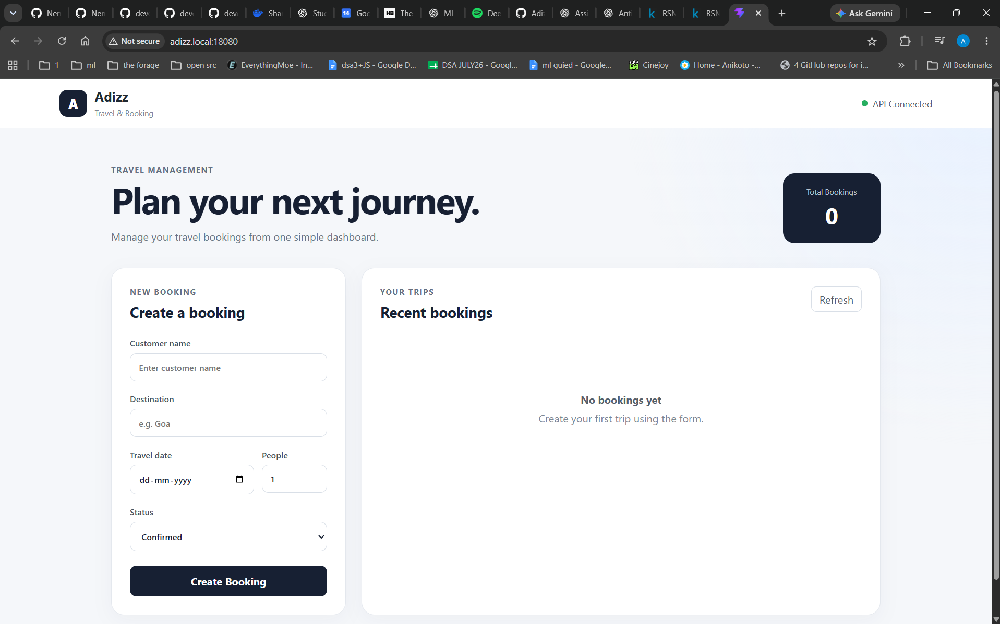
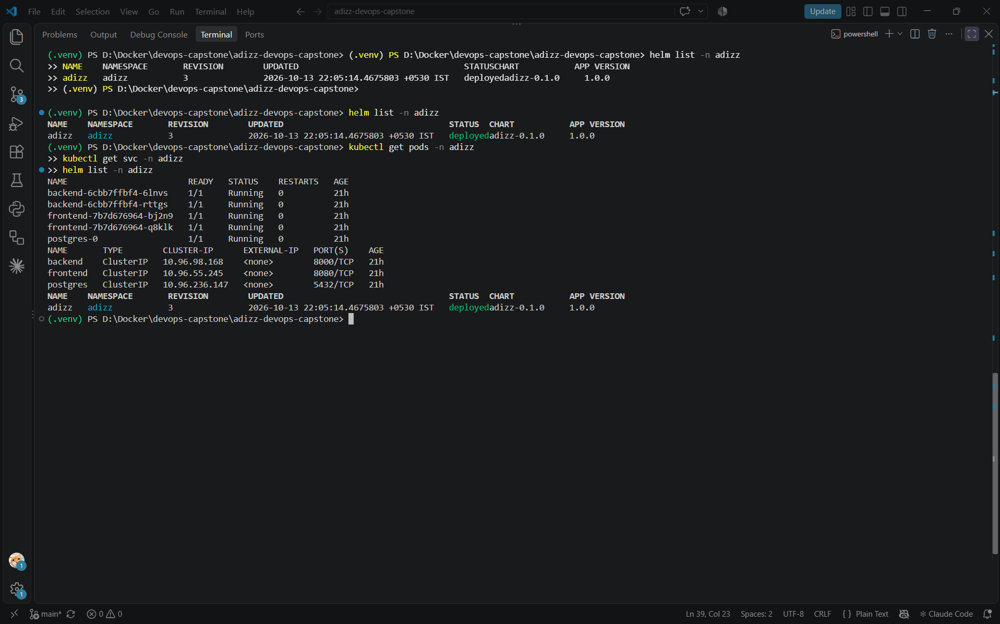
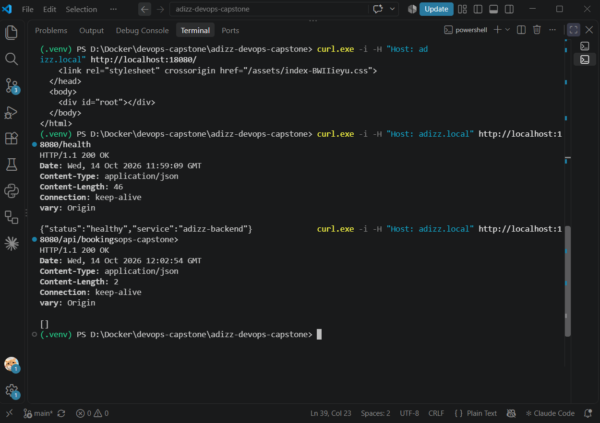
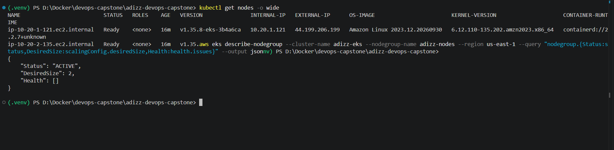
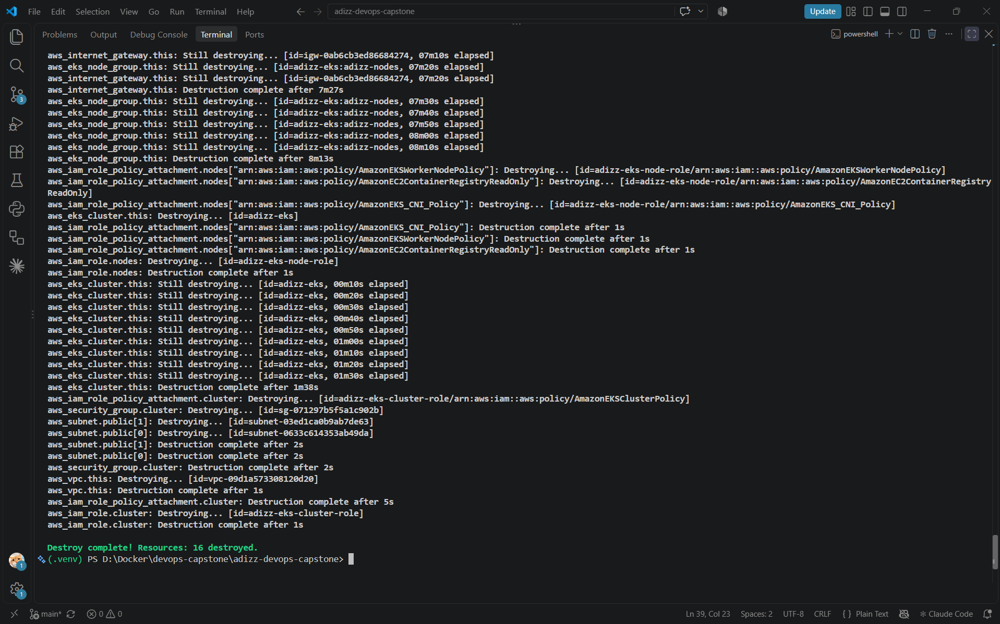
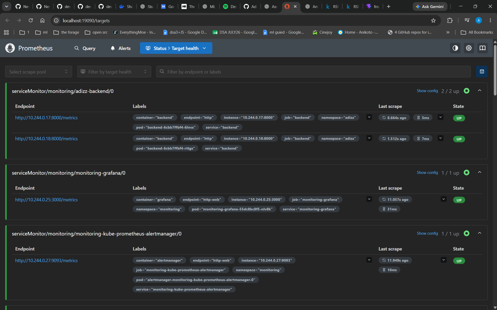
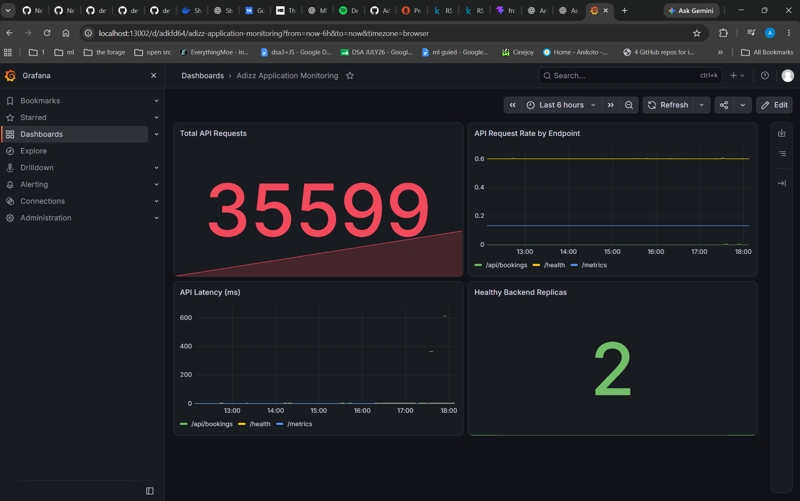

# Adizz — Travel & Booking Management System

A DevOps capstone project that demonstrates a containerized travel-booking application, automated testing and image publishing, Kubernetes deployment, Infrastructure as Code, and application monitoring.

**Repository:** [Adizz20/adizz-devops-capstone](https://github.com/Adizz20/adizz-devops-capstone)  
**Branch:** `main`  
**Frontend:** React + Vite  
**Backend:** FastAPI  
**Database:** PostgreSQL + Alembic  
**Container registry:** GitHub Container Registry (GHCR)

---

## Project overview

Adizz provides a simple travel-booking dashboard where a user can create and review bookings. The React frontend communicates with the FastAPI backend, which exposes health, booking, and Prometheus metrics endpoints. PostgreSQL persists application data.

The project is packaged into Docker images and validated through GitHub Actions. Kubernetes manifests/Helm manage the app deployment, while Prometheus and Grafana provide monitoring. Terraform was used to provision the AWS network and EKS resources for infrastructure verification; those Terraform-managed AWS resources were destroyed after verification to avoid ongoing charges.

## Application preview



*The application is open through the local Ingress hostname, and the header reports that the API is connected.*

### Main application capabilities

- Create a booking using customer name, destination, travel date, passenger count, and booking status.
- View recent bookings and refresh the list.
- Communicate with a FastAPI backend.
- Expose health and Prometheus metrics endpoints for operational checks.

---

## Architecture

```text
Browser
  |
  v
NGINX Ingress (adizz.local)
  |                         |
  | /                       | /api, /health, /metrics
  v                         v
React + Vite             FastAPI backend (2 replicas)
                              |
                              v
                         PostgreSQL
                              |
                              v
                       Prometheus scrape
                              |
                              v
                         Grafana dashboard

GitHub push
    |
    v
GitHub Actions
  ├── Backend pytest suite
  ├── Frontend build
  ├── Build and publish Docker images to GHCR
  └── Trivy image security scans

Terraform -> AWS VPC / public subnets / EKS (created, verified, then destroyed)
```

## Technology stack

| Layer | Tools | Purpose |
|---|---|---|
| Frontend | React, Vite, NGINX | Responsive booking interface and static asset serving |
| Backend | FastAPI, Uvicorn | REST API, health endpoint, metrics endpoint |
| Data | PostgreSQL, SQLAlchemy/Alembic | Persistent booking data and schema migrations |
| Testing | pytest | Automated backend/API tests |
| Containers | Docker, Docker Compose | Reproducible images and local multi-service development |
| CI/CD | GitHub Actions | Tests, frontend build, image publication, security gates |
| Registry | GHCR | Versioned backend and frontend images |
| Security | Trivy | Container image vulnerability scanning |
| Orchestration | Kubernetes, Helm, NGINX Ingress | Deployments, replicas, services, and HTTP routing |
| Observability | Prometheus, Grafana | Scraping application metrics and visualizing health/traffic |
| Infrastructure | Terraform, AWS VPC, EKS | Infrastructure provisioning and verification |

---

## Deployment and application evidence

### Kubernetes workload



This screenshot documents the local Kind cluster's Adizz namespace. The terminal output showed two backend pods, two frontend pods, and the PostgreSQL pod Running; the Ingress resource was also present.

### API endpoint verification



The screenshot records terminal checks performed against the application endpoints. The backend exposes `/health`, booking API routes under `/api`, and `/metrics`.

---

## CI/CD and container security

### Successful GitHub Actions workflow

The workflow is configured to run backend tests, build the frontend, build and publish backend/frontend container images to GHCR, and run Trivy scans.

- [Open GitHub Actions runs](https://github.com/Adizz20/adizz-devops-capstone/actions)
- [Open the GitHub account's package list](https://github.com/Adizz20?tab=packages)

The successful run captured during verification displayed green checks for **Backend Tests**, **Frontend Build**, **Build and Publish Docker Images**, and **Trivy Security Scan**.

### Container packages

The project publishes two packages:

- `adizz-backend`
- `adizz-frontend`

The images are tagged by the workflow so that builds can be associated with a source revision.

### Trivy scanning

Trivy runs against both published images. The workflow is configured to fail for HIGH and CRITICAL findings according to the project's security gate. The screenshot of the successful workflow is evidence that the configured scan job completed successfully; it should not be interpreted as proof that every possible vulnerability in every dependency is absent.

---

## Infrastructure as Code: Terraform and AWS

### Terraform CLI evidence



This terminal screenshot is retained as evidence of the Terraform/AWS command workflow.

### EKS and AWS CLI evidence



This screenshot provides additional terminal evidence from the AWS/EKS workflow. During verification, the EKS cluster and its two worker nodes were checked using the CLI.

**Cost note:** The Terraform-managed AWS resources were destroyed after verification. These screenshots are historical evidence of provisioning and checking the infrastructure, not a claim that the EKS cluster is still running.

---

## Monitoring and observability

### Prometheus targets



Prometheus target health showed the Adizz backend scrape targets in the **UP** state. The backend metrics endpoint is `/metrics`, and the ServiceMonitor is configured to scrape the backend in the `adizz` namespace.

### Grafana dashboard



The dashboard includes panels for:

- **Total API Requests** — cumulative request counter.
- **API Request Rate by Endpoint** — traffic rate grouped by endpoint.
- **API Latency (ms)** — observed API request latency.
- **Healthy Backend Replicas** — number of healthy backend replicas.

These panels demonstrate how the application can be observed while it is running in the local Kind environment.

---

## Run locally

Requirements: Docker Desktop with Kubernetes/Kind available, Git, and optionally Python/Node.js if running services outside containers.

From the repository root:

```powershell
# Start the application and PostgreSQL services
docker compose up --build -d

# Check running containers
docker compose ps

# Run backend tests (activate the project's virtual environment first if used)
pytest -v
```

The Compose configuration maps the frontend to `http://localhost:3000` and the backend to `http://localhost:8000`. Check the repository's current `docker-compose.yml` and `.env.example` for exact local configuration before starting services.

For the Kubernetes workflow, use the Helm values/manifests and monitoring configuration committed in the repository. The captured browser screenshot used the local hostname `adizz.local`; local Ingress and port-forward setup may be needed depending on the machine.

## Useful links

- **Source repository:** https://github.com/Adizz20/adizz-devops-capstone
- **GitHub Actions:** https://github.com/Adizz20/adizz-devops-capstone/actions
- **GHCR packages:** https://github.com/Adizz20?tab=packages

## Submission evidence index

| Rubric area | Evidence included | Notes |
|---|---|---|
| Application | `images/07-adizz-running-in-browser.png` | Browser screenshot with API Connected |
| Kubernetes / Helm / Ingress | `images/08-kubernetes-pods-services-helm.png` | Workload and Ingress terminal evidence |
| API | `images/09-api-endpoint-verification.png` | Endpoint verification terminal screenshot |
| Terraform / AWS | `images/05-terraform-cli-output.png`, `images/06-terraform-eks-cli-evidence.png` | Historical infrastructure workflow evidence |
| Prometheus | `images/10-prometheus-targets-up.png` | Backend targets UP |
| Grafana | `images/11-grafana-application-dashboard.png` | Application monitoring dashboard |
| CI/CD and Trivy | GitHub Actions link above | Open the successful workflow run to show the job checks |
| Live demo | To be performed | Make a small meaningful change, push it, show the workflow passing, and verify the application |

## Final notes

- The screenshots in `images/` are embedded above using relative paths. Keep the `images` folder beside this README when committing it.
- AWS evidence is historical because the Terraform-managed resources were destroyed after verification.
- Kubernetes, Prometheus, and Grafana evidence represents the local Kind environment.
- Before submission, confirm the repository is public, `.env` and credentials are not committed, and the current GitHub Actions run is green.
- The live demo remains a separate step: push a meaningful code change, show CI/CD progress, and verify the updated application.

## Project Presentation

Download the Adizz DevOps Capstone presentation:

[**Download PowerPoint (.pptx)**](presentation/Adizz_DevOps_Capstone_Presentation.pptx)

## Project Demo

[**Watch or download the Adizz DevOps Capstone recording**](https://github.com/Adizz20/adizz-devops-capstone/releases/tag/v1.0.0)